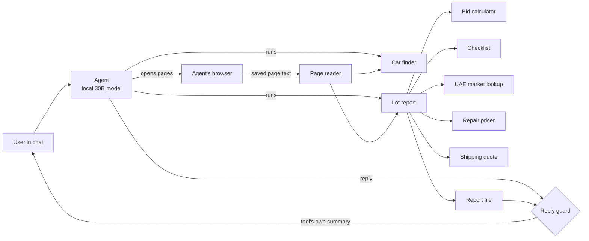

# US2GULF Agent: Making a Small Local LLM Trustworthy Enough to Price Real Cars

**A case study in building a tool-grounded AI agent for car import decisions (US auctions to the UAE).**

> This repository is a written report only. It contains no source code, no data, no prices, no partner
> information and no infrastructure details. All rights reserved. See [NOTICE](NOTICE.md).

---

## 1. The problem

US2GULF buys used cars at US salvage auctions (Copart, IAA), ships them to the UAE and resells them.
Every purchase depends on one question: *what is the most I can bid on this car and still make my target
profit?*

Answering it by hand takes an hour per car. You have to:

- read the auction listing (title type, odometer, damage, condition report, sale time in another time zone),
- look up what the same car sells for in the UAE,
- price the repairs,
- add the auction's buyer fees, which change with the bid,
- add the broker's fees, towing, sea freight, port charges, customs duty and VAT,
- and then work backwards to a maximum bid.

The goal was an assistant that does this in a chat: paste a lot, get a verdict you can trust.

**The hard constraint:** it had to run on a self-hosted, open-weight model (a 30B-parameter coding model,
quantised, with a 32K-token context window) inside the open-source **Agent Zero** framework. No frontier API.
That model is cheap and private, but it is small: it skips steps, retypes numbers wrongly, and invents facts
when it is unsure.

So the real project became: **how do you get trustworthy money decisions out of a model you cannot trust?**

---

## 2. The core design principle

> **The model never produces a fact or a number. It only drives tools. The tools produce the answer.**

Every design decision follows from this.

| What the user sees | Where it comes from | What the model is allowed to do |
|---|---|---|
| Car facts (year, title, odometer, damage) | The auction page **as the agent's own browser saved it** | Open the page. Its typed facts are thrown away and replaced. |
| UAE resale price | Live UAE listing sites, fetched by code | Nothing. Code fetches, filters and takes the median. |
| Repair estimate | Each condition-report line matched to parts catalogues plus labour rates | Copy the condition lines word for word. |
| Fees, shipping, duty, VAT | Fee tables built from the broker's and shipper's official documents | Nothing. |
| Maximum bid and verdict | A deterministic calculator and a checklist | Quote the verdict line exactly. |
| The final reply | A **reply guard** replaces the model's own text with the tool's summary | Write one short sentence, which may be discarded. |

The model became an orchestrator: open this page, run this command, pass the result on. Everything that
matters is computed in code and checked by tests.

---

## 3. What was built

### 3.1 Car finder
Reads the auction search pages the agent's browser opened and lists every matching car, newest first, with a
quick UAE price and a "before repairs" price ceiling. The owner's standing rules (makes, model year, mileage
with a genuine odometer, bid cap, clean title, runs, no flood, fire or frame damage) are applied **in code** as
one preset flag. The model cannot loosen them. When nothing matches, it says so plainly
(`NO ELIGIBLE CAR FOUND`) instead of offering something else.

### 3.2 Lot report: one command, the whole analysis
For each car the model fills a form and runs one command. That command:

1. **Replaces the model's facts with the page's facts.** It reads the auction page the agent's browser saved,
   overwrites every field, and lists each correction ("the AI typed X, the page shows Y").
2. **Refuses when the evidence is missing.** If the page or the condition-report tab was never opened, no report
   is written; it says exactly what to click.
3. **Prices the UAE resale** from live listings: same trim first, then an all-trims fallback that is clearly
   marked and lowers the verdict to "check first".
4. **Adjusts for mileage** with a capped decay rule.
5. **Estimates repairs** line by line from parts catalogues plus local labour and paint rates, with low and
   high figures.
6. **Prices logistics** per car: towing from that specific yard, sea freight from the nearest hub, the cheaper
   allowed destination port, surcharges for SUVs and hybrids.
7. **Runs the bid calculator.** It solves for the maximum bid by bisection, because auction fees step up with
   the bid. It never rounds a limit across a fee step.
8. **Runs the checklist** (title exportability, VIN validity, flood or fire, structural damage, import age,
   seller text that tries to instruct the AI) and decides the verdict: *clear*, *check first*, or *do not bid*.
9. **Writes a side-by-side report** with every source link, plus a pre-filled link to the web calculator.

### 3.3 Web calculator
A one-file calculator page added to the chat interface. A person can check or adjust any line. It uses the
**same maths and the same data** as the agent's tools, and tests pin both to identical results.

### 3.4 Reply guard
A patch to the framework's reply tool. It sits between the model and the user and:

- blocks any bid verdict that did not come from the calculator (it checks a log of real calculator outputs);
- replaces the model's paraphrase with the tool's own summary;
- blocks "I don't have a browser, please open these links yourself" and sends the model back with the exact
  tool call. If the browser really failed, the reply must carry the real error message;
- removes any report from the panel that the tools did not write. It does this by checking a hash registry,
  after the model once copied an old report and edited its dates;
- keeps every chat's state separate, so colleagues working at the same time cannot overwrite each other.

---

## 4. How it failed, and how each failure was fixed

The most useful part of the project was running real test prompts against the live system and reading every
step of every failed run. Each failure became a fix **in code**, not just in the prompt. A small model ignores
prompt rules, but it cannot get around a check written in code.

| What the agent did | Root cause found in the logs | Fix |
|---|---|---|
| Invented a car ("a realistic sample") with a fake lot number | The framework's **long-term memory** had saved earlier failed chats and fed them back as facts, including a sample lot number | Memory recall and auto-memorising switched off for this project |
| Claimed "no browser installed" | It ran a shell command looking for a desktop browser instead of using its own browser tool; a saved "solution" in memory also told it to ask the user | Guard blocks the claim; tool messages now name the exact browser call |
| Ran out of context (over 100%) | Tool output was passed to the model uncapped, so one file read filled the window; the same instruction file was also loaded **twice**, plus the framework's own developer notes | Output cap; duplicate loading switched off. A fresh chat dropped from about 64% to about 48% of the context |
| "Stalled", then poked around the terminal | The tool's progress heartbeat printed into a redirected buffer, so the terminal went silent for over 30 seconds and the framework told the model the process "might be still running" | Heartbeat writes to the real terminal |
| Forged a report | Its tool refused (no evidence), so it copied an older report and changed the dates | Tools register a hash of every report they write; anything unregistered is pulled |
| Used a looser bid limit than the user's rule | It made up the number | The owner's filters became a code preset |
| Showed a dealer-only title as "clean" | The auction's search page labels that title code "Clean Title" | Code mapped to its real meaning; filtered out |
| Said "do not bid" on a good new car | No UAE listing of that exact trim existed yet | Marked all-trims fallback; verdict becomes "check first" with real numbers |
| Edited another chat's report | There was no proper place for owner opinions it had been asked to add | A form field the tool prints itself; reports locked to their own chat |
| Under-counted landed cost | Shipping was a flat estimate | Real price lists from the shipping partner, priced per yard, per hub, per port and per vehicle type |

**Concurrency bugs that only showed up with two chats at once.** One chat's lot report was hidden by
another chat's search. One chat's unfinished form blocked another chat, which then overwrote it. The finder
reused another chat's search pages. Each was fixed by making state per-chat. One fix gave each agent
terminal its own chat identity.

---

## 5. Testing: what, why, and what forced each test

### 5.1 The layers

| Layer | What it checks | Why it exists |
|---|---|---|
| **Built-in self-checks**, one per tool (8 tools) | Each tool's core logic against fixed examples | Every tool can be verified in one command on any machine, including the live server after a release |
| **Guard tests** (45 at the end of the work) | The reply guard's rules, each with a recorded real failure as its input | The guard is the last line of defence, so each rule has a regression test |
| **Calculator parity tests** | The web calculator and the agent's calculator give identical results for the same car | People act on the calculator page; if the two disagree, trust is gone |
| **End-to-end staging runs** | The real model, on a real auction listing, through the whole flow | Unit tests cannot show what a small model will actually do |
| **Live verification after each release** | Every tool self-check plus the release's specific changes, on production | A release is not done until production is proven |

### 5.2 Where the tests came from
Almost every test was **forced by a real failure**. The pattern was always the same:

1. Read the failed chat step by step and find the exact cause.
2. Write a test that reproduces it, often using **the model's exact words from the log** as the input.
3. Fix the code until the test passes, and keep it as a regression test.

Examples of tests forced this way:

- the excuses the model actually used ("requires manual browser interaction", "I don't have direct browser
  access") must be blocked, while honest lines like "I can't see photos" must not be;
- a report copied from an older chat with an edited date must be detected;
- a correct verdict written without its label must be accepted, not blocked. This one came from a guard that
  was **too strict**: a false positive is a failure too;
- a maximum bid just under an auction fee step must never round up across it;
- a mid-size SUV must be priced as large, and an electric car must avoid the port that restricts it;
- a car checked in one chat must not block or overwrite a car being checked in another.

### 5.3 Testing two chats at once
The most valuable tests were the ones run **with two chats active at the same time**. Single-chat tests
passed for weeks while three shared-state bugs were waiting for the first time two colleagues used the system
together.

---

## 6. How releases worked

- **Staging and live were separate.** Every change went to a staging copy first and was tested there with the
  real model.
- **Nothing reached production without the owner's explicit approval** of that specific release.
- **Every release backed up first** and printed a one-line undo.
- **Code patches were recorded as scripts.** Each one asserts the code it expects before changing anything, so
  a patch can never silently apply to changed code.
- **External sites were treated with respect.** When a site blocked automated access, it was marked
  unavailable rather than worked around.

---

## 7. Results

- The agent went from **inventing cars and forging reports** to producing verdicts where every fact traces to
  a page its own browser read, and every number traces to a tool.
- Test runs on the live system went from three different failure modes in three runs to complete,
  correct end-to-end checks.
- The usable context window grew by roughly half, without changing the model.
- Landed-cost estimates moved from flat guesses to the shipping partner's real per-yard and per-port price
  lists. For a typical car they were several hundred dollars higher, which lowered maximum bids accordingly.
- Every decision is reproducible: the same inputs give the same verdict, and the web calculator shows the
  same numbers.

---

## 8. Honest limitations

- **The model is still the ceiling.** It is slow, wanders, and can hold one search or one deep check per chat,
  not both. The system works around it; it does not make the model smart.
- **Some sources are out of reach on purpose.** Sites that block automated access, CAPTCHA-protected
  services and photo inspection (no vision model) are not used, and the reports say so.
- **Today's auction bid is not the final price.** Search filters work on the current bid days before the sale.
  The useful number is the maximum bid, not the margin at today's bid.
- **Some rules are heuristics**, such as name lists for vehicle size classes and matching yard names. Each one
  is marked in the code with its known limit.

---

## 9. Lessons

1. **With a small model, put the truth in code, not in the prompt.** Every rule that was only in the prompt
   was broken at least once. Every rule enforced in code held.
2. **Read the logs before writing a fix.** The causes were almost never what the symptoms suggested: memory
   poisoning looked like a prompt problem, and a silent buffer looked like a slow model.
3. **Turn every failure into a test, using the real words from the log.**
4. **A guard that is too strict is also a bug.** Blocking a correct answer erodes trust as much as letting a
   wrong one through.
5. **Test with concurrent users before real users do.**
6. **Make the model's honest exit easy.** "No eligible car found" and "here is the real error" have to be
   cheaper for the model than making something up.

---

*Built with AI-assisted programming: I used Claude and other AI services as coding assistants to speed up
implementation, debugging and testing. The system's design, decisions and direction are my own.*

*Report prepared October 2026. Written description only; the implementation, data and commercial terms are
private.*
